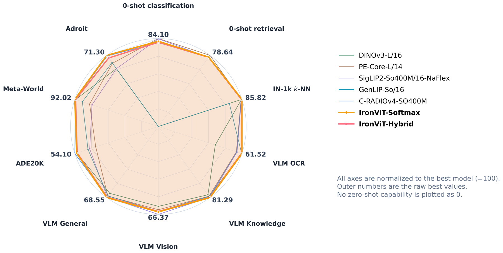

# IronViT: Toward Efficient Generalist Visual Representation Learning

**[XPENG Robotics](https://xpeng-robotics.github.io/iron-fm/?model=vit)**

[](https://arxiv.org/abs/2609.29252)
[](https://xpeng-robotics.github.io/iron-fm/?model=vit)
[](https://huggingface.co/IRONVIT)

Jiaxi Huang, Yueqi Hu, Xin Zhu, Xiaopeng Zhang, Huiting Qiao, Yanglin Zhang, Zefeng Ji, Rongxue Li, Yifei Xu, Huiying Yu, Wei Liu, Jiayin Zheng, Yinggan Xu, Peipeng Chen, Yin Zhang, Jian Yao

Reference PyTorch implementation and models for IronViT. For details, see the **[IronViT](https://arxiv.org/abs/2609.29252)** paper.

## Overview

<p align="center">
  
</p>

IronViT is a family of ~400M-parameter vision encoders that consolidate several
specialised teachers — semantics, spatial structure and image-level
discrimination — into one encoder that reads out both dense patch tokens and a
pooled image vector. The softmax variant follows the Qwen3-VL vision tower; the
hybrid variant swaps most of its softmax attention for linear attention.

## Model Zoo

| Model | Attention | Params | Checkpoint |
|---|---|---|---|
| IronViT-Softmax-400M | softmax, 27/27 blocks | 421M | [Download](https://huggingface.co/IRONVIT/IronViT-Softmax-400M) |
| IronViT-Hybrid-400M | softmax 9/27 + linear 18/27 | 445M | [Download](https://huggingface.co/IRONVIT/IronViT-Hybrid-400M) |

The hybrid model replaces 18 of 27 softmax blocks with linear attention to
reduce high-resolution prefill cost, within half a point of the softmax model
on every probe below. In this pure-PyTorch implementation (no Triton kernel), its
single-image forward pass is 1.00× / 1.16× / 1.38× faster than the softmax
model at 1024² / 1536² / 2048².

## Results

| Model | IN-1k linear | IN-1k kNN | IN-1k zero-shot | ADE20K mIoU | NYUv2 RMSE ↓ |
|---|---|---|---|---|---|
| **IronViT-Softmax-400M** | 87.35 | **85.82** | **83.27** | **52.97** | 0.339 |
| **IronViT-Hybrid-400M** | 87.12 | 85.37 | 82.88 | 52.60 | 0.343 |
| SigLIP2 NaFlex SO400M | **87.45** | 85.28 | — | 44.48 | 0.459 |
| DINOv3-L | 87.07 | 85.42 | — | 52.86 | **0.320** |
| Qwen3-VL ViT (teacher) | 78.28 | 80.22 | — | 33.81 | 0.503 |

The last three rows are published baselines. The Qwen3-VL row is the
language-alignment teacher, not the initialisation of IronViT. Probe scripts are
in `evals/`; numbers follow the paper's Tables 3 and 5.

## Installation

```shell
git clone https://github.com/xpeng-robotics-foundation/IronViT
cd IronViT
pip install -r requirements.txt
```

`ironvit/` can also be installed as a package with `pip install -e .`.

## Quick Start

Checkpoints are hosted on the Hugging Face Hub and loaded with `trust_remote_code=True`:

```python
import torch
from PIL import Image
from transformers import AutoImageProcessor, AutoModel

model_id = "IRONVIT/IronViT-Softmax-400M"  # or "IRONVIT/IronViT-Hybrid-400M"
device = "cuda" if torch.cuda.is_available() else "cpu"
dtype = torch.bfloat16 if device == "cuda" else torch.float32

processor = AutoImageProcessor.from_pretrained(model_id, trust_remote_code=True)
model = AutoModel.from_pretrained(model_id, trust_remote_code=True, dtype=dtype).to(device).eval()

image = Image.open("example.jpg").convert("RGB")
inputs = processor(image, return_tensors="pt").to(device)

with torch.inference_mode():
    outputs = model(**inputs)

patch_grid = model.to_raster_order(outputs.patch_features, inputs["image_grid_thw"])[0]
print("global_features:", tuple(outputs.global_features.shape))  # (1, 1152)
print("patch_features: ", tuple(outputs.patch_features.shape))   # (num_patches, 1152)
print("patch_grid:     ", tuple(patch_grid.shape))               # (gh, gw, 1152)
```

- **Outputs**: `global_features` gives one MAP-pooled vector per image; `patch_features` packs dense patch tokens in Qwen3-VL blocked order (`spatial_merge_size = 2`), which `model.to_raster_order(...)` restores to per-image `[gh, gw, 1152]` spatial grids.
- **Resolution**: NaViT-style native resolution — supports arbitrary resolutions and aspect ratios (pass `size=None` in the processor for dynamic resizing).

## Evaluation

Frozen-backbone probe scripts for all five benchmarks in the table above live in `evals/`:

```shell
# ImageNet-1k (linear probe, kNN, zero-shot)
python evals/linear.py       --model IRONVIT/IronViT-Softmax-400M --data-root <PATH/TO/IMAGENET> --image-size 384
python evals/knn.py          --model IRONVIT/IronViT-Softmax-400M --data-root <PATH/TO/IMAGENET> --image-size 384
python evals/zeroshot.py     --model IRONVIT/IronViT-Softmax-400M --data-root <PATH/TO/IMAGENET>

# Dense prediction (ADE20K segmentation, NYUv2 depth)
python evals/segmentation.py --model IRONVIT/IronViT-Softmax-400M --data-root <PATH/TO/ADE20K>
python evals/depth.py        --model IRONVIT/IronViT-Softmax-400M --data-root <PATH/TO/NYU>
```

See [evals/README.md](evals/README.md) for full probe protocols, zero-shot head details, and dataset preparation.

## Repository Layout

```
ironvit/        model code (config, modeling, image processing)
evals/          frozen-backbone probe scripts
tools/          internal training checkpoint -> release format
tests/          unit tests
assets/         figures used by this README
```

## Citation

```bibtex
@misc{huang2026ironvit,
  title         = {IronViT: Toward Efficient Generalist Visual Representation Learning},
  author        = {Jiaxi Huang and Yueqi Hu and Xin Zhu and Xiaopeng Zhang and Huiting Qiao and
                   Yanglin Zhang and Zefeng Ji and Rongxue Li and Yifei Xu and Huiying Yu and
                   Wei Liu and Jiayin Zheng and Yinggan Xu and Peipeng Chen and Yin Zhang and
                   Jian Yao},
  year          = {2026},
  eprint        = {2609.29252},
  archivePrefix = {arXiv},
  primaryClass  = {cs.CV},
  url           = {https://arxiv.org/abs/2609.29252}
}
```

## License

Apache 2.0 — see [LICENSE](LICENSE).

## Acknowledgements

We thank the authors of
[Qwen3-VL](https://arxiv.org/abs/2511.21631),
[DINOv2](https://arxiv.org/abs/2304.07193),
[DINOv3](https://arxiv.org/abs/2508.10104),
[EUPE](https://arxiv.org/abs/2603.22387) and
[PE](https://arxiv.org/abs/2504.13181), whose work this project builds on.
